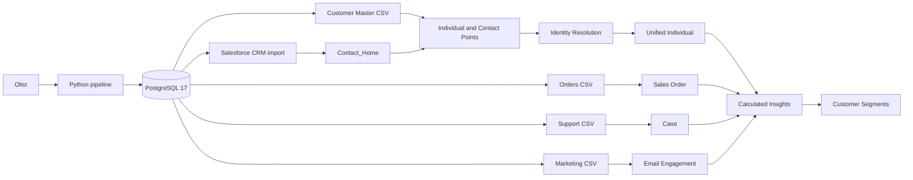
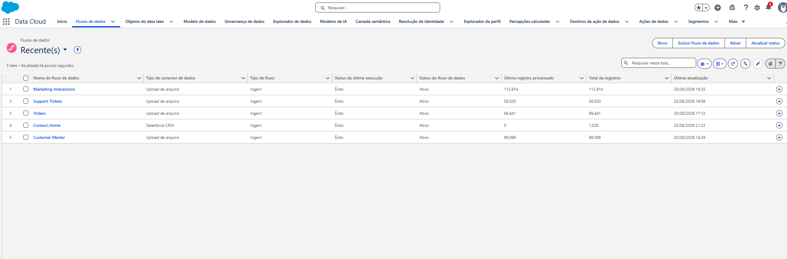
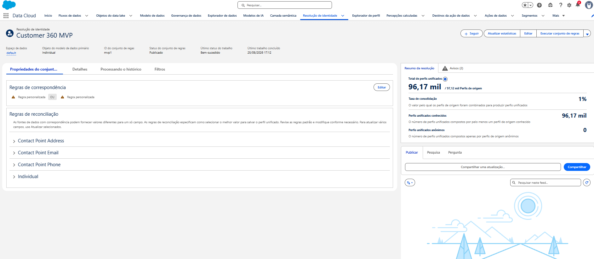

# Customer 360 with Salesforce Data Cloud

[](https://github.com/FelipeEnne/salesforce-data360-customer-intelligence/actions/workflows/ci.yml)

Portfolio MVP demonstrating an end-to-end Customer 360 pipeline with Python, PostgreSQL, Salesforce CRM, and Salesforce Data Cloud.

The project ingests public Olist commerce data, creates deterministic synthetic customer identities and channel activity, loads profile and engagement sources into Data Cloud, resolves CRM and master identities, calculates customer metrics, and builds audience segments.

## Implemented

- Reproducible local pipeline with Python, PostgreSQL 17, Docker Compose, and SQL.
- Customer Master with 96,096 profiles mapped to Individual and Contact Point DMOs.
- 1,000 Salesforce CRM Contacts ingested through a native Data Stream.
- Orders, Support Tickets, and Marketing Interactions mapped as Engagement data.
- Identity Resolution using normalized email or phone.
- Three successfully executed Calculated Insights.
- Two active customer segments.
- End-to-end validation in Profile Explorer.
- Ruff, 13 unit tests, and GitHub Actions CI.

## Architecture





The project imported 1,000 CRM Contacts. The screenshot shows the organization-level `Contact_Home` total displayed by Salesforce at capture time; it is not used as the project import count.

[Architecture](docs/architecture.md) · [Data Cloud setup](docs/data-cloud-setup.md) · [Field mappings](docs/field-mapping.md)

## Data Cloud sources

| Source | Category | DMO | Processed records |
| --- | --- | --- | ---: |
| Customer Master | Profile | Individual and Contact Points | 96,096 |
| Salesforce CRM Contact | Profile | Standard Salesforce mappings | 1,000 imported Contacts |
| Orders | Engagement | Sales Order | 99,441 |
| Support Tickets | Engagement | Case | 58,020 |
| Marketing Interactions | Engagement | Email Engagement | 112,914 |

## Identity Resolution

The `Customer 360 MVP` ruleset (`mvp1`) uses Individual as its primary DMO in the `default` Data Space. Two independent rules joined by `OR` match Exact Normalized Email or Exact Normalized Phone. Individual Id reconciliation uses source priority and prefers Customer Master.

Neither `External_Customer_Id__c` nor `customer_unique_id` is used for matching. They remain ground-truth identifiers for evaluation.



Observed results:

- approximately 97.12K source profiles;
- approximately 96.17K unified profiles;
- 1% consolidation rate;
- 0 anonymous unified profiles.

These are Data Cloud execution totals, not precision, recall, F1, false-positive, or false-negative metrics.

[Identity Resolution details](docs/identity-resolution.md)

## MVP results

| Capability | Observed result |
| --- | --- |
| Customer Order Summary | Lifetime Orders and Lifetime Value calculated successfully |
| Customer Support Summary | Total Tickets calculated successfully |
| Customer Marketing Engagement | Total Interactions calculated successfully |
| High Value Customers | 4,489 members with Lifetime Value greater than 500 |
| High Support Customers | 9,734 members with Total Tickets greater than 3 |
| Profile Explorer validation | Local and Data Cloud values matched for one synthetic customer |

The validated profile showed 1 Lifetime Order, 43.62 Lifetime Value, 1 Total Ticket, and 1 Total Interaction in both the local source and Data Cloud.

[Measured results and screenshots](docs/results.md)

## MVP scope

The completed MVP includes Customer Master, Salesforce CRM Contacts, Orders, Support Tickets, Marketing Interactions, Identity Resolution, Calculated Insights, segments, and Profile Explorer validation.

Products and Web Events are generated locally but are explicitly outside the Data Cloud MVP.

Names, email addresses, phone numbers, and customer attributes generated by the project are synthetic demonstration data.

## Run locally

```bash
cp .env.example .env
make setup
make pipeline
```

Replace the password placeholder in `.env` before starting. See [local setup and pipeline commands](docs/running-locally.md).

## Documentation

- [Architecture](docs/architecture.md)
- [Data sources](docs/data-sources.md)
- [Data dictionary](docs/data-dictionary.md)
- [Data Cloud setup](docs/data-cloud-setup.md)
- [Field mappings](docs/field-mapping.md)
- [Identity Resolution](docs/identity-resolution.md)
- [Measured results](docs/results.md)
- [Identity evaluation workflow](docs/identity-evaluation.md)

## Future Improvements

- Export Unified Profile memberships and calculate identity-matching quality metrics.
- Version and deploy Data Cloud metadata where supported.
- Add Agentforce, MCP, or custom API integrations.
- Explore streaming and incremental ingestion.
- Add production deployment, consent, retention, and observability controls.
- Evaluate Products and Web Events as possible post-MVP sources.

## Dataset attribution

The transactional source is the public **Brazilian E-Commerce Public Dataset by Olist**, obtained through Kaggle Hub (`olistbr/brazilian-ecommerce`). Source data is intentionally not versioned in this repository.

## License

The project code and documentation are available under the [MIT License](LICENSE). The license does not replace or modify terms applicable to the Olist dataset or third-party services.
