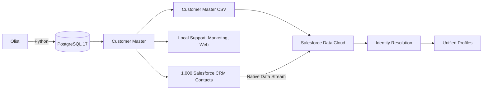

# Customer 360 with Salesforce Data Cloud

[](https://github.com/FelipeEnne/salesforce-data360-customer-intelligence/actions/workflows/ci.yml)

Customer 360 MVP for preparing and matching fragmented customer records across commerce, CRM, support, marketing, and web sources.

The project builds a reproducible local data pipeline from the public Olist dataset, adds deterministic synthetic identities and cross-channel activity, and exports independent sources for Salesforce CRM and Salesforce Data Cloud.

> The local pipeline and Data Cloud MVP are implemented. Customer Master and Salesforce CRM Contacts have been ingested, and Identity Resolution has run successfully. Quantitative accuracy metrics have not yet been calculated.

## The problem

The same customer can appear differently in each system: an uppercase email address in CRM, a formatted phone number in support, a missing identifier in marketing, or an anonymous browser ID on the website. This project creates controlled identity variations and retains ground truth so matching strategies can be evaluated against known relationships.

## Architecture



The pipeline downloads and loads Olist data, generates deterministic customer identities and source-specific quality variations, validates the datasets with SQL, and creates separate CRM, Data Cloud, and evaluation exports. The current Data Cloud implementation includes Customer Master and Salesforce CRM Contacts; the other generated sources remain local.

[Data Cloud setup](docs/data-cloud-setup.md) · [Field mappings](docs/field-mapping.md) · [Identity Resolution](docs/identity-resolution.md)

## Technology stack

- Python, psycopg, Faker, and Kaggle Hub
- PostgreSQL 17 and SQL
- Docker Compose
- GitHub Actions and Python unittest
- Salesforce CRM
- Salesforce Data Cloud

## Data sources

| Source | Purpose | Data Cloud status |
| --- | --- | --- |
| Olist | Public commerce transactions | Local source only |
| Customer Master | Synthetic reference identity | Loaded: 96,096 profiles |
| Salesforce Contacts | CRM-style contact records | Loaded: 1,000 Contacts |
| Support | Simulated service tickets | Not loaded |
| Marketing | Simulated campaign engagement | Not loaded |
| Web Events | Anonymous-to-known journeys | Not loaded |

[Data source details](docs/data-sources.md) · [Data dictionary](docs/data-dictionary.md)

## Identity Resolution

The `Customer 360 MVP` ruleset (`mvp1`) uses Individual as its primary DMO. Two independent rules joined by `OR` match Exact Normalized Email or Exact Normalized E.164 Phone. Name is excluded because the dataset contains intentional name variations, and `External_Customer_Id__c` is excluded so it remains independent evaluation ground truth.

Individual Id reconciliation uses Source Priority, with Customer Master ahead of `Contact_Home`, and ignores empty values. The ruleset has executed successfully; its configuration is documented, but its metadata is not deployed automatically by this repository.

## MVP results

A representative local run produced:

| Output | Records |
| --- | ---: |
| Customer Master | 96,096 |
| Salesforce Contacts | 96,096 |
| Salesforce CRM import sample | 1,000 |
| Support Tickets | 58,020 |
| Marketing Interactions | 112,914 |
| Web Events | 177,982 |
| Orders | 99,441 |
| Products | 32,951 |

These are pipeline output counts, not measured Data Cloud unification results.

The current Data Cloud run reports approximately 97.12K source profiles, 96.17K unified known profiles, a 1% consolidation rate, and no anonymous unified profiles. Precision and recall will be evaluated separately against ground truth.

The [quantitative evaluation workflow](docs/identity-evaluation.md) is ready and requires a detailed Unified Profile membership export from Data Cloud before metrics can be calculated.

## Run locally

```bash
cp .env.example .env
make setup
make pipeline
```

Replace the password placeholder in `.env` before starting the pipeline. Use `make help` to list individual commands or see [Local setup and pipeline commands](docs/running-locally.md).

## Repository structure

```text
.
├── docs/              # Architecture, sources, and local setup
├── data/              # Ignored raw and generated datasets
├── sql/schema/        # PostgreSQL schemas and tables
├── sql/analytics/     # Data-quality validation queries
├── src/generators/    # Deterministic source generation
├── src/ingestion/     # Download, loading, and exports
└── Makefile           # Local workflow commands
```

## Future improvements

- Version Data Cloud mappings and Identity Resolution rules where supported.
- Export Unified Profile memberships and run the ground-truth evaluation.
- Add automated tests, CI checks, dependency pinning, and orchestration.
- Support incremental ingestion and near-real-time web events.
- Add consent, retention, observability, and activation examples.

## Dataset attribution

The transactional source is the public **Brazilian E-Commerce Public Dataset by Olist**, obtained through Kaggle Hub (`olistbr/brazilian-ecommerce`). Source data is intentionally not versioned in this repository.
