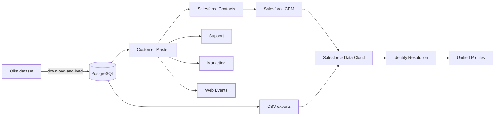

# Customer 360 with Salesforce Data Cloud

Customer 360 MVP that brings transactional, profile, and behavioral data together into an integrated customer view. The project uses Python, PostgreSQL, and Docker to prepare sources with different data quality levels, Salesforce CRM as a contact source, and Salesforce Data Cloud for **Identity Resolution**.

The lab starts with the public Brazilian E-Commerce dataset (Olist), enriches customers with synthetic identities, and creates simulated CRM, support, marketing, and web browsing signals. The final exports are CSV files designed to support the configuration of data streams and reconciliation rules in Data Cloud.

> This is an educational demonstration project. Names, email addresses, phone numbers, and other enriched attributes are synthetic. Generated files must not be treated as production data.

## Architecture



PostgreSQL provides the local preparation and validation environment. The generators use hashes and deterministic rules, so the same input produces the same identities, quality profiles, and interactions. The `customer_unique_id` is retained internally as evaluation ground truth, while operational exports omit this direct link from several sources. This makes it possible to test resolution through attributes such as email address, phone number, name, and anonymous identifiers.

Salesforce Data Cloud is not run by this repository's Docker Compose stack. Data streams, Data Lake Objects, Data Model Objects, match rules, and reconciliation rules are configured in the Salesforce/Data Cloud organization used for the demonstration.

## Data sources

| Source | Local model | Purpose |
| --- | --- | --- |
| Olist | `olist.*` | E-commerce customers, orders, items, payments, reviews, products, sellers, and geolocation |
| Customer Master | `crm.customer_master` | Reference identity, synthetically enriched from Olist customers |
| Salesforce Contacts | `crm.salesforce_contacts` | CRM contact representation with controlled quality variations |
| Support | `support.tickets` | Simulated service history and requester identity signals |
| Marketing | `marketing.interactions` | Simulated email campaign and engagement events |
| Web Events | `web.events` | Anonymous and known digital journeys grouped by browser and session |

### Customer Master

This is the lab's internal reference: one record for each Olist `customer_unique_id`, enriched with a name, email address, E.164 phone number, and date of birth. These attributes are synthetic and generated deterministically. The master is the basis for creating the remaining sources and provides the ground truth used to measure unification quality.

### Salesforce Contacts

This source simulates contacts maintained in Salesforce CRM. Each contact receives a Salesforce Contact-like ID, a lead source, and a status. To create a realistic Identity Resolution scenario, some records contain uppercase email addresses, differently formatted phone numbers, abbreviated names, small typos, or missing fields.

The project also exports a balanced sample of 1,000 contacts for use with the Salesforce Data Import Wizard. The corresponding ground-truth file is for evaluation only and must not be imported into the CRM.

### Support

This source represents support tickets received through email, chat, phone, or WhatsApp. Records include category, priority, status, sentiment, creation and resolution timestamps, and requester attributes. Approximately 30% of customers receive one to three tickets, also with controlled variations in identity data.

### Marketing

This source represents campaign interactions such as sends, opens, clicks, conversions, and unsubscribes. About 70% of customers participate in a campaign. The email address may be clean, uppercase, or missing, creating another source for matching and unification.

### Web Events

This source represents sessions containing `page_view`, `product_view`, `add_to_cart`, `checkout_started`, and `purchase` events. Browsing begins with an `anonymous_id` and `session_id`; at identification points such as checkout or purchase, events may start carrying an email address and a known reference. This sequence demonstrates how Data Cloud can link anonymous activity to an identified profile.

## Ingestion flow

1. `download_olist.py` downloads the public dataset through Kaggle Hub into `data/raw/olist`.
2. PostgreSQL initializes the schemas and tables defined under `sql/schema`.
3. `load_olist.py` loads the raw CSV files into the `olist.*` tables.
4. The generators create Customer Master, Salesforce Contacts, Support, Marketing, and Web Events, in that order.
5. Queries under `sql/analytics` validate integrity, coverage, and quality distributions.
6. `export_salesforce_crm_sample.py` prepares the sample for Salesforce CRM import.
7. `export_data360.py` produces operational CSV files and evaluation ground truth.
8. Salesforce CRM and the exported CSV files feed Salesforce Data Cloud, where Identity Resolution matches records and creates unified profiles.

## Repository structure

```text
.
├── data/
│   ├── raw/                 # Local downloads; contents ignored by Git
│   ├── processed/           # Local exports; contents ignored by Git
│   └── synthetic/           # Reserved area for synthetic data
├── sql/
│   ├── schema/              # Schema and table initialization
│   └── analytics/           # MVP validation queries
├── src/
│   ├── generators/          # Deterministic generation of simulated sources
│   └── ingestion/           # Data download, loading, and export
├── .env.example             # Reference local configuration
├── docker-compose.yml       # Local PostgreSQL service
└── requirements.txt         # Python dependencies
```

## Run locally

### Prerequisites

- Docker with Docker Compose
- Python 3.10 or newer
- Access to download the public Olist dataset through Kaggle Hub

Depending on the Kaggle Hub configuration in your environment, downloading may require Kaggle credentials. Do not commit credential files or tokens.

### 1. Create the Python environment

```bash
python -m venv .venv
source .venv/bin/activate
python -m pip install --upgrade pip
python -m pip install -r requirements.txt
cp .env.example .env
```

The example configuration connects to PostgreSQL at `localhost:5433`. Replace the placeholder password in your local `.env`; Docker Compose reads the same variable without requiring credentials to be committed.

### 2. Start PostgreSQL

```bash
docker compose up -d
docker compose ps
```

The SQL files under `sql/schema` are applied automatically when the `postgres_data` volume is created for the first time. Changes to those files are not reapplied automatically to an existing volume.

### 3. Download and load Olist

```bash
python src/ingestion/download_olist.py
python src/ingestion/load_olist.py
```

### 4. Generate the Customer 360 sources

Run the generators in dependency order:

```bash
python src/generators/generate_customer_master.py
python src/generators/generate_salesforce_contacts.py
python src/generators/generate_support_tickets.py
python src/generators/generate_marketing_interactions.py
python src/generators/generate_web_events.py
```

The scripts use upserts for generated entities, making repeated executions deterministic for the same Olist input. The Olist loader truncates each destination table before reloading it.

### 5. Run validation queries

Run an individual validation with `psql` inside the container:

```bash
docker compose exec -T postgres psql -U data360 -d customer360 < sql/analytics/001_validate_olist.sql
docker compose exec -T postgres psql -U data360 -d customer360 < sql/analytics/002_validate_customer_master.sql
docker compose exec -T postgres psql -U data360 -d customer360 < sql/analytics/003_validate_salesforce_contacts.sql
docker compose exec -T postgres psql -U data360 -d customer360 < sql/analytics/004_validate_support_tickets.sql
docker compose exec -T postgres psql -U data360 -d customer360 < sql/analytics/005_validate_marketing_interactions.sql
docker compose exec -T postgres psql -U data360 -d customer360 < sql/analytics/006_validate_web_events.sql
```

### 6. Export for Salesforce CRM and Data Cloud

```bash
python src/ingestion/export_salesforce_crm_sample.py
python src/ingestion/export_data360.py
```

Generated files are written below `data/processed`:

- `salesforce/contacts_import.csv`: sample intended for Salesforce CRM import;
- `salesforce/contacts_ground_truth.csv`: internal evaluation only;
- `data360/*.csv`: source files for Data Cloud ingestion;
- `evaluation/identity_ground_truth.csv`: expected cross-source relationships for evaluation.

### 7. Stop the local database

```bash
docker compose down
```

This preserves the named PostgreSQL volume. Removing the volume also removes the local database and is intentionally not part of the standard workflow.

## Salesforce Data Cloud and Identity Resolution

After the data streams are ingested and mapped to the appropriate data model, Identity Resolution can use normalized identifiers and fuzzy or exact match rules to associate records from CRM, support, marketing, commerce and web activity. Reconciliation rules then choose which source contributes the preferred value to the unified profile.

The `customer_unique_id` and the files under `data/processed/evaluation` are ground truth for assessing the MVP. They should not be used as a shortcut in production-like matching rules. The intended exercise is to resolve identities from source-visible fields such as e-mail, phone, name, Salesforce Contact ID and anonymous web identifiers.

## MVP Results

A representative local run currently produces:

| Output | Records |
| --- | ---: |
| Customer Master | 96,096 |
| Salesforce Contacts | 96,096 |
| Salesforce CRM import sample | 1,000 |
| Support Tickets | 58,020 |
| Marketing Interactions | 112,914 |
| Web Events | 177,982 |
| Orders | 99,441 |
| Products | 32,951 |

The MVP demonstrates a reproducible multi-source dataset with known identity relationships, deliberate data-quality variations and exports suitable for testing Data Cloud ingestion and Identity Resolution. Counts may change if the upstream dataset or generation rules are changed.

## Data and Git hygiene

The repository tracks only placeholder files inside `data`. The following must remain local and are ignored by Git:

- downloaded Olist CSVs under `data/raw`;
- all generated exports under `data/processed`;
- evaluation and ground-truth files;
- `.env`, virtual environments, caches, logs and database dumps;
- Kaggle and Salesforce credentials or tokens.

Before publishing changes, verify the staged content with:

```bash
git status --short
git diff --cached --stat
```

## Future Improvements

- Version Data Cloud mappings, match rules and reconciliation rules as deployable metadata where supported.
- Add automated tests for deterministic generation, schema contracts and referential integrity.
- Add a task runner or orchestration layer for the complete pipeline.
- Pin dependency versions and add dependency/security scanning.
- Add CI checks for linting, tests, SQL validation and accidental secret or large-file inclusion.
- Measure Identity Resolution precision, recall and match-rate against the exported ground truth.
- Add incremental ingestion, change data capture and near-real-time web event streaming.
- Introduce consent, data classification, retention and deletion workflows for production readiness.
- Add observability for freshness, volume, schema drift and data-quality thresholds.
- Expand activation examples, such as audience segmentation and downstream Salesforce journeys.

## Dataset attribution

The transactional source is the public **Brazilian E-Commerce Public Dataset by Olist**, obtained through Kaggle Hub (`olistbr/brazilian-ecommerce`). Review the dataset page and its applicable terms before redistributing source data. This repository intentionally does not version the downloaded dataset.
