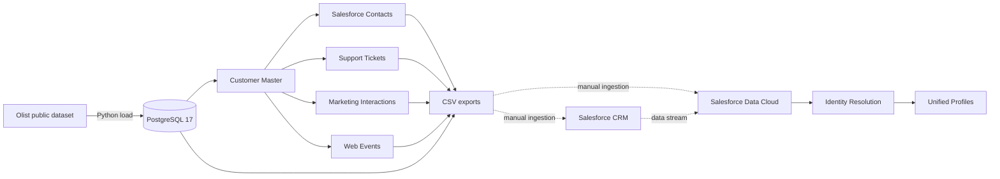
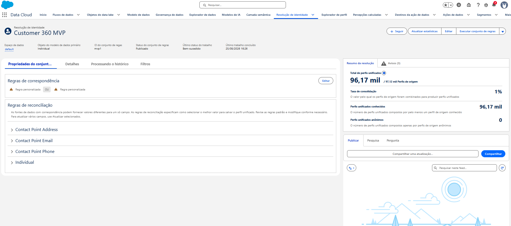

# Customer 360 with Salesforce Data Cloud

This project is a Customer 360 MVP for testing how fragmented customer records can be prepared and matched across commerce, CRM, support, marketing, and web sources. It builds a reproducible local data pipeline and produces source files for Salesforce CRM and Salesforce Data Cloud.

> Scope: the local pipeline, synthetic source generation, validation queries, and CSV exports are implemented in this repository. Salesforce CRM import and Data Cloud configuration are external, manual steps. No Data Cloud metadata or measured Identity Resolution results are versioned here yet.

## At a glance

| Area | Summary |
| --- | --- |
| Problem | Customer identity is split across systems and represented with inconsistent names, email addresses, phone formats, missing values, and anonymous web identifiers. |
| Approach | Build a trusted Customer Master, generate controlled source variations, retain evaluation ground truth, and export each source independently for matching in Data Cloud. |
| Stack | Python, PostgreSQL 17, Docker Compose, SQL, psycopg, Faker, Kaggle Hub, Salesforce CRM, and Salesforce Data Cloud. |
| Data | Public Olist commerce data plus synthetic Customer Master, Salesforce Contacts, Support, Marketing, and Web Events. |
| Current output | 96,096 master customers, 96,096 CRM-style contacts, 58,020 support tickets, 112,914 marketing interactions, and 177,982 web events in a representative local run. |

Names, email addresses, phone numbers, and other enriched identity attributes are synthetic. Generated files are demonstration data, not production data.

## Problem

A single customer can appear differently in each operational system: an uppercase email address in CRM, a formatted phone number in support, a missing identifier in marketing, or an anonymous browser ID on the website. The project creates these variations deliberately so that identity matching can be tested against known relationships instead of a perfectly clean dataset.

## Architecture



Python downloads and loads Olist data, then generates deterministic customer identities and cross-channel activity in PostgreSQL. SQL scripts create the source schemas and validate record quality. Separate CSV exports are produced for CRM import, Data Cloud ingestion, and offline evaluation.

Salesforce CRM and Data Cloud are outside the local Docker environment. Their ingestion mappings and Identity Resolution rules must be configured in a Salesforce organization.

## Identity Resolution


*Salesforce Data Cloud Identity Resolution consolidating Customer Master and Salesforce CRM profiles using normalized email and phone matching.*

## Technology stack

| Technology | Role |
| --- | --- |
| Python | Dataset download, ingestion, deterministic data generation, and export |
| PostgreSQL 17 | Local storage, source separation, joins, and validation |
| Docker Compose | Reproducible local database environment |
| SQL | Schema initialization and data-quality checks |
| Kaggle Hub / Olist | Public transactional source |
| Salesforce CRM | Target for the generated contact import sample |
| Salesforce Data Cloud | Target platform for ingestion, data-model mapping, and Identity Resolution |

## Data sources

| Source | Local model | What it represents | Identity signals |
| --- | --- | --- | --- |
| Olist | `olist.*` | Customers, orders, items, payments, reviews, products, sellers, and geolocation | Olist customer identifiers |
| Customer Master | `crm.customer_master` | One synthetic reference identity per Olist customer | Name, email, E.164 phone, birth date |
| Salesforce Contacts | `crm.salesforce_contacts` | CRM-style contacts with lead source and status | Salesforce-like ID, name, email, phone |
| Support | `support.tickets` | Tickets across email, chat, phone, and WhatsApp | Requester name, email, phone |
| Marketing | `marketing.interactions` | Sends, opens, clicks, conversions, and unsubscribes | Email and campaign activity |
| Web Events | `web.events` | Anonymous-to-known browsing and purchase sessions | Anonymous ID, session ID, email |

The generated sources contain controlled quality profiles: clean records, uppercase email addresses, formatted phone numbers, abbreviated names, small name typos, and missing email or phone values. Web sessions begin anonymously and may become known at checkout or purchase.

## Identity Resolution design

The local pipeline keeps `customer_unique_id` as ground truth so expected cross-source relationships are known. Operational exports intentionally omit this direct identifier from several sources. The intended Data Cloud flow is:

1. Ingest CRM and CSV sources as separate data streams.
2. Map source fields to the relevant Data Model Objects.
3. Normalize identifiers such as email addresses and phone numbers.
4. Apply exact or fuzzy match rules across email, phone, name, Salesforce Contact ID, and web identifiers.
5. Apply reconciliation rules to select preferred attributes for a unified profile.
6. Compare resolved relationships with `identity_ground_truth.csv`.

Steps 1–5 are Data Cloud configuration work and are not automated in this repository. The ground-truth export exists, but precision, recall, and match-rate have not yet been measured.

## Current results

A representative local run produced:

| Output | Records |
| --- | ---: |
| Customer Master | 96,096 |
| Salesforce Contacts | 96,096 |
| Salesforce CRM import sample | 1,000 |
| Support Tickets | 58,020 |
| Marketing Interactions | 112,914 |
| Web Events | 177,982 |
| Orders | 99,441 |
| Products | 32,951 |

These results confirm that the local pipeline can build repeatable, multi-source test data and export known identity relationships. They are pipeline output counts, not proof of completed Data Cloud unification.

## Pipeline flow

1. Download Olist CSV files with `download_olist.py`.
2. Initialize PostgreSQL schemas and load the raw tables with `load_olist.py`.
3. Generate Customer Master, Salesforce Contacts, Support, Marketing, and Web Events.
4. Run SQL checks for integrity, coverage, event consistency, and quality-profile distributions.
5. Export a 1,000-contact CRM sample, Data Cloud source files, and identity ground truth.
6. Manually import and configure the relevant sources in Salesforce CRM and Data Cloud.

## Repository structure

```text
.
├── data/
│   ├── raw/                 # Local downloads; contents ignored by Git
│   ├── processed/           # Local exports; contents ignored by Git
│   └── synthetic/           # Reserved area for synthetic data
├── sql/
│   ├── schema/              # Schema and table initialization
│   └── analytics/           # MVP validation queries
├── src/
│   ├── generators/          # Deterministic generation of simulated sources
│   └── ingestion/           # Data download, loading, and export
├── .env.example             # Reference local configuration
├── docker-compose.yml       # Local PostgreSQL service
└── requirements.txt         # Python dependencies
```

## Run locally

### Prerequisites

- Docker with Docker Compose
- Python 3.10 or newer
- Access to download the public Olist dataset through Kaggle Hub

Depending on the Kaggle Hub configuration in your environment, downloading may require Kaggle credentials. Do not commit credential files or tokens.

### 1. Create the Python environment

```bash
python -m venv .venv
source .venv/bin/activate
python -m pip install --upgrade pip
python -m pip install -r requirements.txt
cp .env.example .env
```

The example configuration connects to PostgreSQL at `localhost:5433`. Replace the placeholder password in your local `.env`; Docker Compose reads the same variable without requiring credentials to be committed.

### 2. Start PostgreSQL

```bash
docker compose up -d
docker compose ps
```

The SQL files under `sql/schema` are applied automatically when the `postgres_data` volume is created for the first time. Changes to those files are not reapplied automatically to an existing volume.

### 3. Download and load Olist

```bash
python src/ingestion/download_olist.py
python src/ingestion/load_olist.py
```

### 4. Generate the Customer 360 sources

Run the generators in dependency order:

```bash
python src/generators/generate_customer_master.py
python src/generators/generate_salesforce_contacts.py
python src/generators/generate_support_tickets.py
python src/generators/generate_marketing_interactions.py
python src/generators/generate_web_events.py
```

The scripts use upserts for generated entities, making repeated executions deterministic for the same Olist input. The Olist loader truncates each destination table before reloading it.

### 5. Run validation queries

Run an individual validation with `psql` inside the container:

```bash
docker compose exec -T postgres psql -U data360 -d customer360 < sql/analytics/001_validate_olist.sql
docker compose exec -T postgres psql -U data360 -d customer360 < sql/analytics/002_validate_customer_master.sql
docker compose exec -T postgres psql -U data360 -d customer360 < sql/analytics/003_validate_salesforce_contacts.sql
docker compose exec -T postgres psql -U data360 -d customer360 < sql/analytics/004_validate_support_tickets.sql
docker compose exec -T postgres psql -U data360 -d customer360 < sql/analytics/005_validate_marketing_interactions.sql
docker compose exec -T postgres psql -U data360 -d customer360 < sql/analytics/006_validate_web_events.sql
```

### 6. Export for Salesforce CRM and Data Cloud

```bash
python src/ingestion/export_salesforce_crm_sample.py
python src/ingestion/export_data360.py
```

Generated files are written below `data/processed`:

- `salesforce/contacts_import.csv`: sample intended for Salesforce CRM import;
- `salesforce/contacts_ground_truth.csv`: internal evaluation only;
- `data360/*.csv`: source files for Data Cloud ingestion;
- `evaluation/identity_ground_truth.csv`: expected cross-source relationships for evaluation.

### 7. Stop the local database

```bash
docker compose down
```

This preserves the named PostgreSQL volume. Removing the volume also removes the local database and is intentionally not part of the standard workflow.

## Data and Git hygiene

The repository tracks only placeholder files inside `data`. The following must remain local and are ignored by Git:

- downloaded Olist CSVs under `data/raw`;
- all generated exports under `data/processed`;
- evaluation and ground-truth files;
- `.env`, virtual environments, caches, logs and database dumps;
- Kaggle and Salesforce credentials or tokens.

Before publishing changes, verify the staged content with:

```bash
git status --short
git diff --cached --stat
```

## Future Improvements

- Version Data Cloud mappings, match rules and reconciliation rules as deployable metadata where supported.
- Add automated tests for deterministic generation, schema contracts and referential integrity.
- Add a task runner or orchestration layer for the complete pipeline.
- Pin dependency versions and add dependency/security scanning.
- Add CI checks for linting, tests, SQL validation and accidental secret or large-file inclusion.
- Measure Identity Resolution precision, recall and match-rate against the exported ground truth.
- Add incremental ingestion, change data capture and near-real-time web event streaming.
- Introduce consent, data classification, retention and deletion workflows for production readiness.
- Add observability for freshness, volume, schema drift and data-quality thresholds.
- Expand activation examples, such as audience segmentation and downstream Salesforce journeys.

## Dataset attribution

The transactional source is the public **Brazilian E-Commerce Public Dataset by Olist**, obtained through Kaggle Hub (`olistbr/brazilian-ecommerce`). Review the dataset page and its applicable terms before redistributing source data. This repository intentionally does not version the downloaded dataset.
