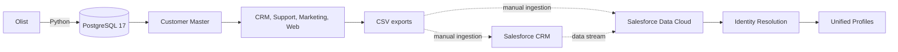

# Customer 360 with Salesforce Data Cloud

Customer 360 MVP for preparing and matching fragmented customer records across commerce, CRM, support, marketing, and web sources.

The project builds a reproducible local data pipeline from the public Olist dataset, adds deterministic synthetic identities and cross-channel activity, and exports independent sources for Salesforce CRM and Salesforce Data Cloud.

> The local pipeline, validation queries, and CSV exports are implemented. Salesforce CRM import and Data Cloud configuration are manual external steps. Identity Resolution metrics have not yet been measured.

## The problem

The same customer can appear differently in each system: an uppercase email address in CRM, a formatted phone number in support, a missing identifier in marketing, or an anonymous browser ID on the website. This project creates controlled identity variations and retains ground truth so matching strategies can be evaluated against known relationships.

## Architecture



The pipeline downloads and loads Olist data, generates deterministic customer identities and source-specific quality variations, validates the datasets with SQL, and creates separate CRM, Data Cloud, and evaluation exports.

[Architecture and Identity Resolution details](docs/architecture.md)

## Technology stack

- Python, psycopg, Faker, and Kaggle Hub
- PostgreSQL 17 and SQL
- Docker Compose
- Salesforce CRM
- Salesforce Data Cloud

## Data sources

| Source | Purpose | Identity signals |
| --- | --- | --- |
| Olist | Public commerce transactions | Customer and order identifiers |
| Customer Master | Synthetic reference identity | Name, email, E.164 phone, birth date |
| Salesforce Contacts | CRM-style contact records | Salesforce-like ID, name, email, phone |
| Support | Simulated service tickets | Requester name, email, phone |
| Marketing | Simulated campaign engagement | Email and campaign activity |
| Web Events | Anonymous-to-known journeys | Anonymous ID, session ID, email |

[Data source and quality-profile details](docs/data-sources.md)

## Identity Resolution

The local pipeline retains `customer_unique_id` as evaluation ground truth but omits it from several operational exports. In Data Cloud, the intended approach is to map each source to the data model, normalize identity fields, apply exact or fuzzy match rules, reconcile preferred attributes, and compare the unified relationships with the ground-truth export.

Data Cloud rules and metadata are not automated or versioned in this repository yet.

## MVP results

A representative local run produced:

| Output | Records |
| --- | ---: |
| Customer Master | 96,096 |
| Salesforce Contacts | 96,096 |
| Salesforce CRM import sample | 1,000 |
| Support Tickets | 58,020 |
| Marketing Interactions | 112,914 |
| Web Events | 177,982 |
| Orders | 99,441 |
| Products | 32,951 |

These are pipeline output counts, not measured Data Cloud unification results.

## Run locally

See [Local setup and pipeline commands](docs/running-locally.md).

## Repository structure

```text
.
├── docs/              # Architecture, sources, and local setup
├── data/              # Ignored raw and generated datasets
├── sql/schema/        # PostgreSQL schemas and tables
├── sql/analytics/     # Data-quality validation queries
├── src/generators/    # Deterministic source generation
└── src/ingestion/     # Download, loading, and exports
```

## Future improvements

- Version Data Cloud mappings and Identity Resolution rules where supported.
- Measure precision, recall, and match rate against the ground truth.
- Add automated tests, CI checks, dependency pinning, and orchestration.
- Support incremental ingestion and near-real-time web events.
- Add consent, retention, observability, and activation examples.

## Dataset attribution

The transactional source is the public **Brazilian E-Commerce Public Dataset by Olist**, obtained through Kaggle Hub (`olistbr/brazilian-ecommerce`). Source data is intentionally not versioned in this repository.
