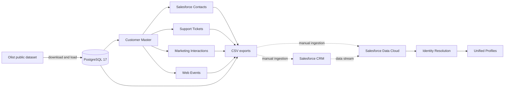

# Architecture and Identity Resolution

## Components

PostgreSQL provides the local preparation and validation environment. Python scripts download and load the public source, generate deterministic identities and interactions, and export source-specific CSV files. SQL scripts initialize the database and validate integrity, event consistency, coverage, and quality distributions.

Salesforce CRM and Salesforce Data Cloud are outside the local Docker environment. CRM import, data streams, Data Lake Objects, Data Model Objects, match rules, and reconciliation rules must be configured in a Salesforce organization.

## Pipeline flow

1. Download the Olist CSV files through Kaggle Hub.
2. Initialize PostgreSQL schemas and load the raw tables.
3. Generate the Customer Master from unique Olist customers.
4. Generate Salesforce Contacts, Support, Marketing, and Web Events.
5. Run SQL validation queries.
6. Export a Salesforce CRM sample, Data Cloud source files, and evaluation ground truth.
7. Manually ingest and map the relevant sources in Salesforce CRM and Data Cloud.

## Identity Resolution design

The Customer Master supplies a deterministic identity for each Olist customer. Downstream sources deliberately introduce variations such as:

- uppercase email addresses;
- differently formatted phone numbers;
- abbreviated names;
- small name typos;
- missing email addresses or phone numbers;
- anonymous web sessions that become known during checkout or purchase.

The local pipeline retains `customer_unique_id` as ground truth, while several operational exports omit that direct relationship. This supports an evaluation flow in which Data Cloud must resolve records using source-visible identity signals.

The intended Data Cloud process is:

1. Ingest CRM and CSV sources as separate data streams.
2. Map source fields to the relevant Data Model Objects.
3. Normalize email addresses, phone numbers, and other identifiers.
4. Apply exact or fuzzy match rules appropriate to each identity field.
5. Use reconciliation rules to select preferred unified-profile attributes.
6. Compare resolved relationships with `data/processed/evaluation/identity_ground_truth.csv`.

Steps 1–5 are not automated by this repository. The ground-truth export exists, but Identity Resolution precision, recall, and match rate have not yet been measured.

## Export boundaries

Operational exports under `data/processed/data360` are intended as Data Cloud source files. The files under `data/processed/evaluation` contain internal ground truth and must not be ingested as a matching shortcut. The Salesforce ground-truth sample is also for offline evaluation only.

[Back to README](../README.md)
