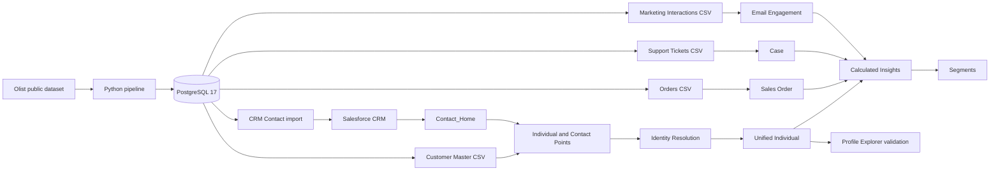
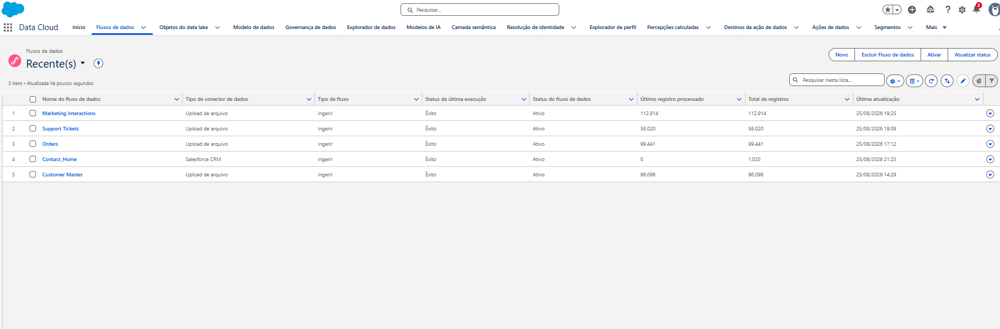

# Architecture

## Implemented architecture

PostgreSQL is the local preparation and validation layer. Python downloads and loads the public Olist source, generates deterministic synthetic identities and engagement data, validates data quality, and exports source-specific CSV files. Salesforce CRM and Salesforce Data Cloud run in a Salesforce Developer Edition organization outside Docker.

The project imported 1,000 Contacts. The screenshot shows the organization-level `Contact_Home` record total visible at capture time, not the project import count.

## Implemented flow

1. Load the Olist dataset into PostgreSQL.
2. Generate the Customer Master, Salesforce Contacts, Support Tickets, Marketing Interactions, and Web Events locally.
3. Validate the local model and export the Salesforce and Data Cloud files.
4. Import 1,000 Contacts into Salesforce CRM.
5. Ingest Customer Master, CRM Contacts, Orders, Support Tickets, and Marketing Interactions into Data Cloud.
6. Map profile data to Individual and Contact Point DMOs and engagement data to Sales Order, Case, and Email Engagement.
7. Resolve Customer Master and CRM identities using normalized email or normalized phone.
8. Calculate order, support, and marketing metrics, then build customer segments.
9. Validate one synthetic customer from the local source through Profile Explorer.

## Identity and engagement model

Only Customer Master and Salesforce CRM Contacts participate as profile sources in Identity Resolution. The `Customer 360 MVP` ruleset uses Exact Normalized Email **or** Exact Normalized Phone. It does not use `customer_unique_id` or `External_Customer_Id__c` as matching criteria.

Orders, Support Tickets, and Marketing Interactions are engagement sources related to Individual through `master_customer_id`. This key provides the relationship to the profile; it is not an Identity Resolution matching rule.

Calculated Insights aggregate the related engagement records into Lifetime Orders, Lifetime Value, Total Tickets, and Total Interactions. The implemented segments use Lifetime Value and Total Tickets.

## MVP boundary

Products and Web Events exist in the local pipeline but are explicitly outside the Data Cloud MVP. Agentforce, MCP, custom APIs, streaming ingestion, and production deployment are future improvements.

## Export boundary

Operational exports under `data/processed/data360` are Data Cloud source files. Files under `data/processed/evaluation` contain internal ground truth and must not be ingested as matching shortcuts.

- [Data Cloud implementation](data-cloud-setup.md)
- [Field mappings](field-mapping.md)
- [Measured results](results.md)
- [Back to README](../README.md)
