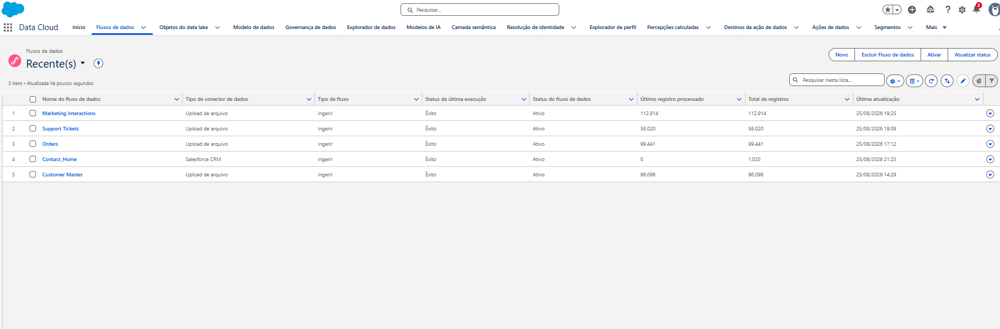
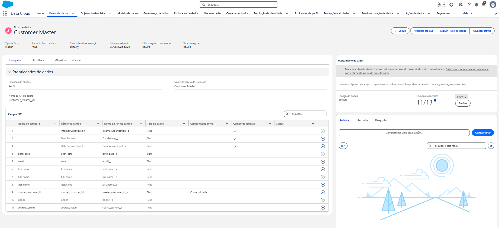

# Salesforce Data Cloud Implementation

## Implementation status

The Customer 360 MVP is implemented in a Salesforce Data Cloud Developer Edition organization. Five Data Streams have processed successfully, Identity Resolution has executed, three Calculated Insights have executed successfully, two segments have observed populations, and one synthetic customer has been validated end to end in Profile Explorer.

The project imported 1,000 Contacts. The screenshot shows the organization-level `Contact_Home` record total visible at capture time, not the project import count.

## Data Streams

| Source | Ingestion | Category | DLO or source object | DMO | Processed records |
| --- | --- | --- | --- | --- | ---: |
| Customer Master | CSV file upload | Profile | `Customer_Master__dll` | Individual and Contact Points | 96,096 |
| Salesforce CRM | Native CRM connection | Profile | `Contact_Home` | Standard Salesforce mappings | 1,000 Contacts imported |
| Orders | CSV file upload | Engagement | — | Sales Order | 99,441 |
| Support Tickets | CSV file upload | Engagement | — | Case | 58,020 |
| Marketing Interactions | CSV file upload | Engagement | — | Email Engagement | 112,914 |

The Data Lake Object names for the three engagement uploads are not recorded here because they were not captured as verified project metadata.

### Customer Master

`Customer Master` uses `master_customer_id` as its primary key and maps to Individual, Contact Point Email, and Contact Point Phone.

### Salesforce CRM

The CRM import completed without failures and included `External_Customer_Id__c`, `Lead_Source__c`, and `Contact_Status__c`. A native Data Stream ingests the `Contact` object into `Contact_Home`. Salesforce standard mappings to Account Contact and related Individual and Contact Point DMOs were preserved.

`External_Customer_Id__c` is evaluation ground truth and is excluded from Identity Resolution matching.

[View the Salesforce CRM Data Stream screenshot](images/salesforce-crm-data-stream.png)

### Engagement sources

Orders map to Sales Order, Support Tickets map to Case, and Marketing Interactions map to Email Engagement. Their `master_customer_id` values relate engagement records to Individual and are not Identity Resolution matching criteria.

- [Orders mapping screenshot](images/orders-sales-order-mapping.png)
- [Support mapping screenshot](images/support-case-mapping.png)
- [Marketing mapping screenshot](images/marketing-email-engagement-mapping.png)

## Identity Resolution

The `Customer 360 MVP` ruleset (`mvp1`) uses Individual in the `default` Data Space. Exact Normalized Email and Exact Normalized Phone are independent rules connected by `OR`. Customer Master has reconciliation priority over Salesforce CRM.

[Configuration and observed execution totals](identity-resolution.md)

## Calculated Insights

All three Calculated Insights executed successfully:

| Calculated Insight | Measures |
| --- | --- |
| Customer Order Summary | Lifetime Orders, Lifetime Value |
| Customer Support Summary | Total Tickets |
| Customer Marketing Engagement | Total Interactions |

[Calculated Insights screenshot](images/calculated-insights.png)

## Segments and validation

- **High Value Customers:** Lifetime Value greater than 500; 4,489 members.
- **High Support Customers:** Total Tickets greater than 3; 9,734 members.
- **Profile Explorer:** a synthetic customer matched the local values for all four calculated measures.

See [measured MVP results](results.md) for evidence and detailed screenshots.

## MVP boundary

Products and Web Events are explicitly outside the current Data Cloud MVP. Agentforce, MCP, custom APIs, streaming ingestion, and production deployment remain future improvements.

## Related documentation

- [Architecture](architecture.md)
- [Field mappings](field-mapping.md)
- [Identity Resolution](identity-resolution.md)
- [Measured results](results.md)
- [Back to README](../README.md)
