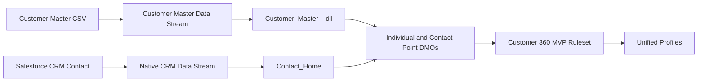

# Salesforce Data Cloud Setup

## Implementation status

This MVP has been implemented in a Salesforce Data Cloud Developer Edition organization. The current Data Cloud scope includes Customer Master and Salesforce CRM Contact data. Both sources have been ingested and mapped, and the Identity Resolution ruleset has run successfully.

Orders, Support, Marketing, and Web Events are generated by the local pipeline but have not been configured as Data Streams in Data Cloud.

## Implemented architecture

## Customer Master ingestion

Customer Master was ingested through a CSV upload.

| Setting | Value |
| --- | --- |
| Data Stream | `Customer Master` |
| DLO | `Customer_Master__dll` |
| Category | Profile |
| Primary key | `master_customer_id` |
| Records processed | 96,096 |
| Status | Completed successfully |

The source is mapped to Individual, Contact Point Email, and Contact Point Phone. See [Field mappings](field-mapping.md) for the field-level configuration.

## Salesforce CRM ingestion

A balanced sample of 1,000 Contacts was imported into Salesforce CRM without failures. The import includes these custom fields:

- `External_Customer_Id__c`
- `Lead_Source__c`
- `Contact_Status__c`

A native Salesforce CRM Data Stream connects the `Contact` object to Data Cloud.

| Setting | Value |
| --- | --- |
| Source | Salesforce CRM |
| Source object | `Contact` |
| Data Stream type | Native Salesforce CRM |
| Generated DLO | `Contact_Home` |
| Contacts imported | 1,000 |
| Import status | Completed without failures |

Salesforce generated the standard mappings to Account Contact and related DMOs, including Individual, Contact Point Email, and Contact Point Phone.

`External_Customer_Id__c` is retained as evaluation ground truth. It is intentionally excluded from Identity Resolution match rules so it cannot act as a direct matching shortcut.

## Current Data Cloud scope

| Source | Available locally | Loaded into Data Cloud |
| --- | :---: | :---: |
| Customer Master | Yes | Yes |
| Salesforce CRM Contacts | Yes | Yes |
| Orders | Yes | No |
| Support | Yes | No |
| Marketing | Yes | No |
| Web Events | Yes | No |

## Related documentation

- [Field mappings](field-mapping.md)
- [Identity Resolution](identity-resolution.md)
- [Data sources](data-sources.md)
- [Back to README](../README.md)
