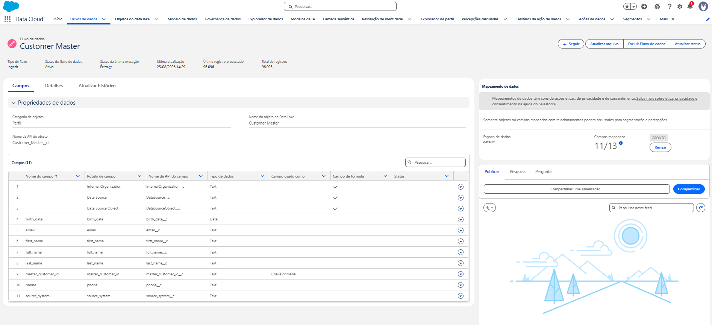

# Data Cloud Field Mappings

## Customer Master

| Setting | Value |
| --- | --- |
| Data Stream | `Customer Master` |
| DLO | `Customer_Master__dll` |
| Category | Profile |
| Primary key | `master_customer_id` |

| Source field | Target DMO | Target field |
| --- | --- | --- |
| `master_customer_id` | Individual | Individual Id |
| `first_name` | Individual | First Name |
| `last_name` | Individual | Last Name |
| `full_name` | Individual | Person Name |
| `birth_date` | Individual | Birth Date |
| `master_customer_id` | Contact Point Email | Contact Point Email Id |
| `master_customer_id` | Contact Point Email | Party |
| `email` | Contact Point Email | Email Address |
| `master_customer_id` | Contact Point Phone | Contact Point Phone Id |
| `master_customer_id` | Contact Point Phone | Party |
| `phone` | Contact Point Phone | Telephone Number |
| `phone` | Contact Point Phone | Formatted E164 Phone Number |

## Salesforce CRM Contact

| Setting | Value |
| --- | --- |
| Source object | `Contact` |
| DLO | `Contact_Home` |
| Mapping | Salesforce standard mappings preserved |

The standard mapping includes Account Contact and related Individual, Contact Point Email, and Contact Point Phone DMOs. The imported Contacts also contain `External_Customer_Id__c`, `Lead_Source__c`, and `Contact_Status__c`. `External_Customer_Id__c` is ground truth and is not used for Identity Resolution.

## Orders to Sales Order

| Source field | Target field |
| --- | --- |
| `order_id` | Sales Order Id |
| `master_customer_id` | Sold To Customer |
| `order_purchase_timestamp` | Created Date |
| `order_status` | Sales Order Status |
| `payment_value` | Paid Amount |

[Orders mapping screenshot](images/orders-sales-order-mapping.png)

## Support Tickets to Case

| Source field | Target field |
| --- | --- |
| `ticket_id` | Case Id |
| `master_customer_id` | Individual |
| `created_at` | Created Date |
| `resolved_at` | Closed Date Time |
| `priority` | Case Priority |
| `status` | Case Status |
| `channel` | Case Creation Channel |
| `category` | Case Category |

[Support mapping screenshot](images/support-case-mapping.png)

## Marketing Interactions to Email Engagement

| Source field | Target field |
| --- | --- |
| `interaction_id` | Email Engagement Id |
| `master_customer_id` | Individual |
| `event_at` | Engagement Date Time |
| `event_type` | Engagement Channel Action |
| `campaign_name` | Email Name |
| `channel` | Engagement Channel |

[Marketing mapping screenshot](images/marketing-email-engagement-mapping.png)

## Identity boundary

For engagement sources, `master_customer_id` is only the foreign key relating the record to Individual. It is not a matching criterion. Identity Resolution uses normalized email or normalized phone from the profile sources only.

Products and Web Events are not mapped into the current Data Cloud MVP.

## Related documentation

- [Data Cloud implementation](data-cloud-setup.md)
- [Identity Resolution](identity-resolution.md)
- [Measured results](results.md)
- [Back to README](../README.md)
