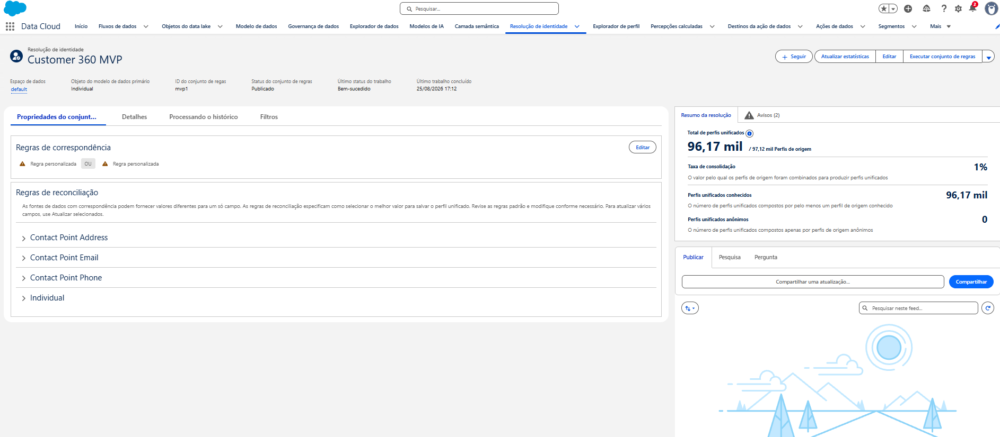

# Identity Resolution

## Implemented ruleset

The ruleset is configured and has executed successfully in Salesforce Data Cloud Developer Edition.

| Setting | Value |
| --- | --- |
| Ruleset name | `Customer 360 MVP` |
| Ruleset ID | `mvp1` |
| Primary DMO | Individual |
| Data Space | `default` |
| Execution status | Completed successfully |

## Matching

Two independent rules are joined by `OR`, so either normalized contact point can match a profile:

| Contact Point DMO | Field | Method |
| --- | --- | --- |
| Contact Point Email | Email Address | Exact Normalized |
| Contact Point Phone | Formatted E164 Phone Number | Exact Normalized |

Name is excluded because the dataset contains intentional name variations. `External_Customer_Id__c` and `customer_unique_id` are also excluded: they are ground truth for later evaluation, not operational matching attributes.

Orders, Support Tickets, and Marketing Interactions are engagement data. Their `master_customer_id` values relate their DMOs to Individual and do not participate in matching.

## Reconciliation

Individual Id uses Source Priority:

| Priority | Source |
| ---: | --- |
| 1 | Customer Master |
| 2 | `Contact_Home` / Salesforce CRM |

`Ignore empty values` is enabled.

## Observed execution results

| Data Cloud metric | Observed result |
| --- | ---: |
| Source profiles | Approximately 97.12K |
| Unified profiles | Approximately 96.17K |
| Consolidation rate | 1% |
| Unified known profiles | Approximately 96.17K |
| Anonymous unified profiles | 0 |

These totals show that the ruleset executed and produced unified profiles. They are not precision, recall, F1, false-positive-rate, or false-negative-rate measurements.

## Profile Explorer validation

One synthetic customer was traced from its local source values to its unified profile. Profile Explorer showed the same values: 1 Lifetime Order, 43.62 Lifetime Value, 1 Total Ticket, and 1 Total Interaction.

This validates the demonstrated profile-to-engagement relationship and Calculated Insight output for that record. It does not measure Identity Resolution accuracy across the population.

[View the measured result and Profile Explorer screenshots](results.md#profile-explorer-end-to-end-validation).

## Quantitative evaluation boundary

The repository includes an [evaluation workflow](identity-evaluation.md), but the detailed Unified Profile membership export required to calculate accuracy metrics has not yet been evaluated. No precision, recall, F1, false-positive rate, or false-negative rate is claimed.

## Related documentation

- [Data Cloud implementation](data-cloud-setup.md)
- [Field mappings](field-mapping.md)
- [Measured results](results.md)
- [Back to README](../README.md)
