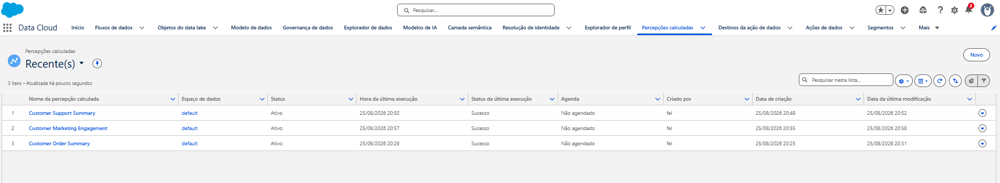
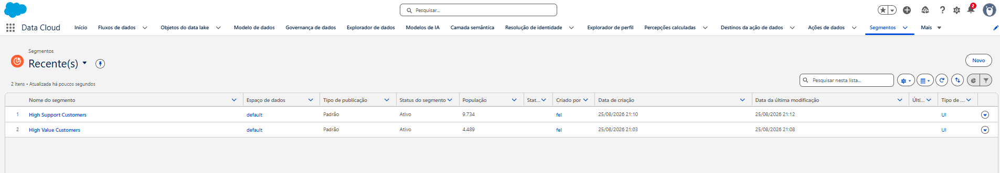

# MVP Results

This page reports observed Salesforce Data Cloud results only. Values are taken from successful Data Stream processing, Identity Resolution execution, Calculated Insights, segments, and Profile Explorer validation.

## Data ingestion

| Source | Observed result |
| --- | ---: |
| Customer Master | 96,096 records processed successfully |
| Salesforce CRM | 1,000 Contacts imported successfully |
| Orders | 99,441 records processed successfully |
| Support Tickets | 58,020 records processed successfully |
| Marketing Interactions | 112,914 records processed successfully |

[View the Data Streams overview](images/data-streams-overview.png). The project imported 1,000 Contacts; the screenshot's `Contact_Home` total is the organization-level total visible at capture time.

## Identity Resolution

| Data Cloud metric | Observed result |
| --- | ---: |
| Source profiles | Approximately 97.12K |
| Unified profiles | Approximately 96.17K |
| Consolidation rate | 1% |
| Anonymous unified profiles | 0 |

[View the Identity Resolution summary](images/identity-resolution-summary.png).

These aggregate execution totals are not precision, recall, F1, false-positive-rate, or false-negative-rate metrics.

## Calculated Insights

All three Calculated Insights executed successfully.

| Calculated Insight | Observed measures |
| --- | --- |
| Customer Order Summary | Lifetime Orders, Lifetime Value |
| Customer Support Summary | Total Tickets |
| Customer Marketing Engagement | Total Interactions |

## Segments

| Segment | Implemented condition | Observed population |
| --- | --- | ---: |
| High Value Customers | Lifetime Value greater than 500 | 4,489 |
| High Support Customers | Total Tickets greater than 3 | 9,734 |

## Profile Explorer end-to-end validation

One synthetic customer was checked against the local source and its Data Cloud unified profile.

| Measure | Local source | Profile Explorer |
| --- | ---: | ---: |
| Lifetime Orders | 1 | 1 |
| Lifetime Value | 43.62 | 43.62 |
| Total Tickets | 1 | 1 |
| Total Interactions | 1 | 1 |

The values matched for this validation record.

- [Unified profile overview](images/profile-explorer-overview.png)
- [Related data](images/profile-explorer-related-data.png)
- [Order insight](images/profile-explorer-orders.png)
- [Support insight](images/profile-explorer-support.png)
- [Marketing insight](images/profile-explorer-marketing.png)

This is an end-to-end validation of one synthetic profile, its related engagement data, and its Calculated Insights. It is not a population-level Identity Resolution accuracy study.

## MVP boundary

Products and Web Events are outside the current Data Cloud MVP. No results are claimed for them.

- [Identity Resolution details](identity-resolution.md)
- [Data Cloud implementation](data-cloud-setup.md)
- [Back to README](../README.md)
